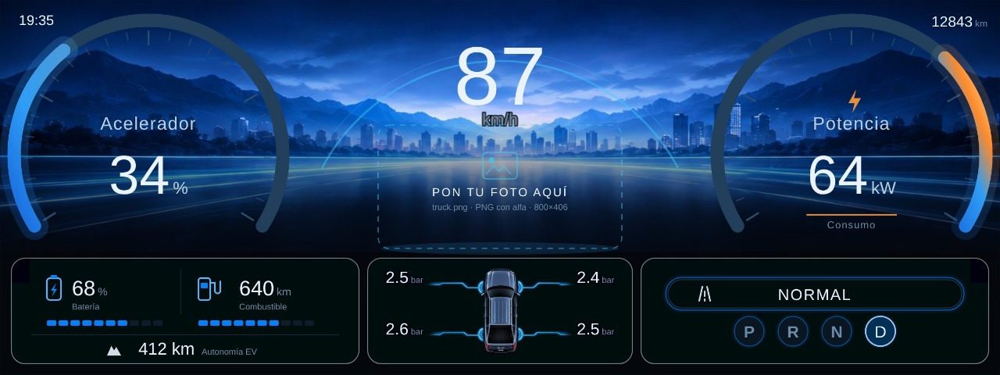
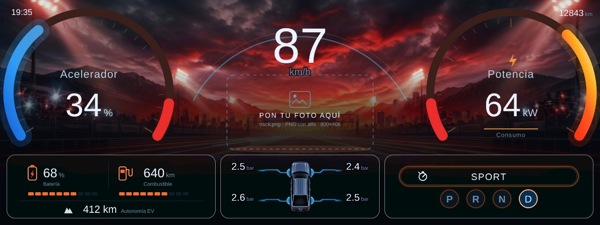
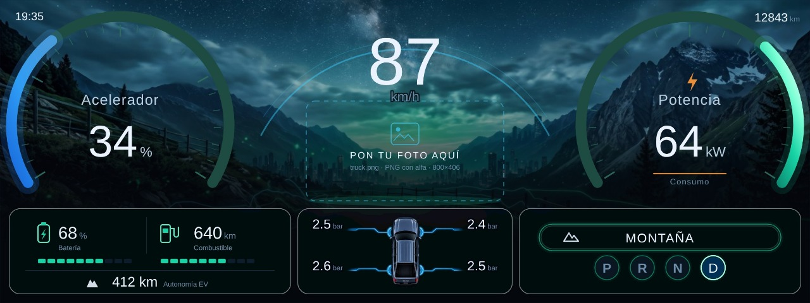
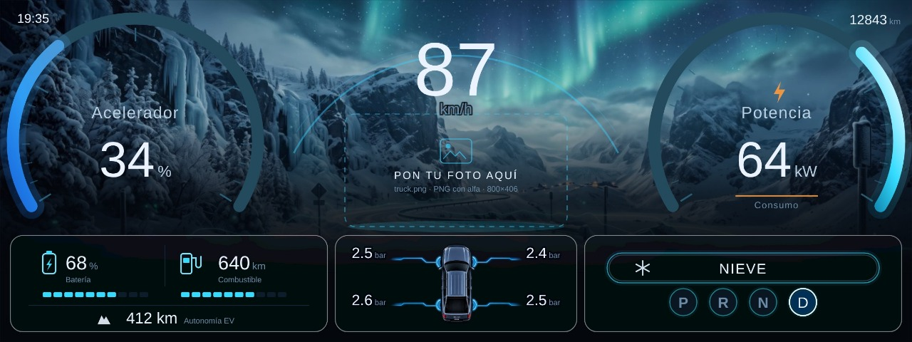
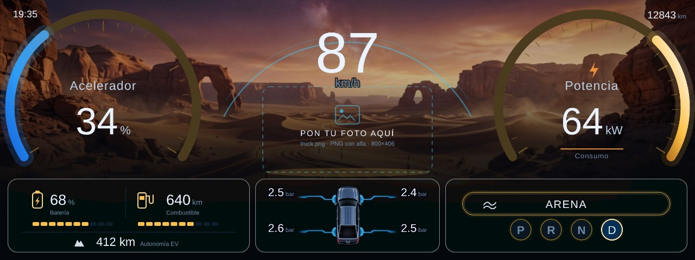
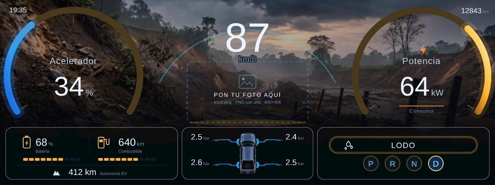

# BYD cluster dashboard

Own cluster panel for BYD vehicles that use the DiLink 3.0 cluster system (the `AutoContainer`
binder plus the `fission` virtual display), with **its own code**: HTML/SVG skins you edit as
text and an Android app that paints them on the head unit and on the cluster behind the
steering wheel, **without depending on the reference cluster app**.

The reference implementation in this repo is called **SharkLab**. It has only been tested on a
**BYD Shark** so far; see [Compatibility](#compatibility).

| Folder | What it is | Status |
|---|---|---|
| `app/` | SharkLab: Android app that paints the skin (~2.6 MB APK with the theme, no Gradle) | **builds and signs** |
| `themes/` | `byd` theme (the only one the app shows) | working |
| `tools/` | Diagnostics and helper scripts: panel FPS, preview server, deploy, keepalive | working |

## Compatibility

| Scope | Status |
|---|---|
| BYD Shark (`BYD_AUTO`, DiLink 3.0, Android 10, 1920×720 panel) | **tested on the car** |
| Other BYD models sharing the same DiLink 3.0 cluster system | expected to work; not verified yet |
| BYD models with a different cluster service or display | needs a port |

The design only relies on the platform contract: the `AutoContainer` binder, a virtual display
for the panel and the BYD vehicle APIs. A different model may expose another display name,
other panel command codes or a different power signal; the
[agent guide](docs/AGENT-IMPLEMENTATION-GUIDE.md#11-porting-to-another-byd-with-dilink-30)
lists the probes to run before adapting the code.

**Contributions are welcome.** If you add support for another BYD, open an issue or PR with the
values you measured on the car (display name, panel commands, power signal) so the next person
does not have to start from zero. Never claim support for a model that has not been tested.


## For AI agents

See [`AGENTS.md`](AGENTS.md): the agent entry point, the tested scope and the hard rules, with
the link to the implementation guide.

**Skin grid:** `byd` draws at **1920×720** with a `viewBox` — the exact cluster frame — and
`width/height="100%"`, so it scales on its own. Side rings with radius ~200 and stroke 14,
centres at x 300/1620 and y 400; dial number 96 (hero 120 in the centre); bottom band cards at
y 560–700; BYD light band at x 700–1220, y 0–60.

The pressure card uses `assets/tyre-stage.png` — art with alpha (1510×897, cropped by the alpha
box) that already carries the top-down car, the four glowing rings on the wheels and the side
rails. It goes in at 112 px of height (~188 wide) and the numbers (2.5 bar) sit at the rail
ends, with margin from the card edges. The art is **the same in every mode** — no scene
filter — and the old art, drawn in SVG, became this PNG: same reading, fewer vertices.

The cards are **transparent glass**: each one clips a blurred copy of the background (`<use
href="#gBg">` with `feGaussianBlur` σ 14 in a region the size of the card, so only the visible
area is filtered). There is **no colour on top**: no tint, no diagonal glow, no neon, no inner
shadow. What you see inside the card is only the blurred background, closed by a light 1.1 px
ring. The background changes with the scene and the glass follows, because the copy is live.

Bottom band, three cards: battery (14..460), **pressures in the middle** (470..810) and modes
(820..1266), all with the `gCard` background. Clock, odometer and temperature stay in the top
corners. The rings grew from R 120 to R 146 with stroke 17 (22 in SPORT), ticks and numbers
scaled, centre at y 196.

`byd` is the only theme with photos, all of them in `themes/dash/byd/assets/`: `bg.jpg`
(landscape), `bg-sport.jpg` (road on embers, SPORT mode), `bg-mountain.jpg` (green mountain
range, mountain mode), `bg-mud.jpg` (jungle road, mud mode), `bg-snow.jpg` (snowy range with
aurora, snow mode), `bg-sand.jpg` (desert with dunes, sand mode) and `tyre-stage.png` /
`tyre-car.png` (top-down car art for the pressure card; the skin draws `tyre-stage.png`).
`truck.png` (cut-out pickup) is **not included**: it is optional and user-supplied, and the
skin draws a placement hint with the file name, format and size until the file exists — see
`themes/dash/byd/assets/README.md`.

## Actual feature status

| Feature | Status |
|---|---|
| Own panel/skin (SVG, 1920×720, light/dark, whole panel, variable width) | ✅ |
| Skin on the cluster behind the wheel, full screen, without depending on the reference cluster app | ✅ |
| The app takes the panel by itself: it sends `AutoContainer` cmd 16 when the window opens and when it comes back to the foreground | ✅ |
| The app shows only the installed themes (today: `byd`) in a grid | ✅ |
| Single screen: theme grid + `APLICAR`/`DESACTIVAR` + auto-start toggle | ✅ |
| Real vehicle data through the DiLink APIs (`android.hardware.bydauto.*`): speed, gear, power, SOC, range, fuel, odometer, temperatures, tyre pressures, driving modes | ✅ |
| Derived values the DiLink APIs do not expose on this unit (battery temperature, trip computer) | ⏳ pending, shown as `-999` |
| Cameras, ADAS, map, Android Auto / CarPlay | ⏳ pending (AA/CarPlay need a Google/Apple licence) |

## Driving modes at a glance

The theme changes its scene, palette and ring colours with the driving mode. Captured from a
clean clone: the dashed card in the centre is the slot for your own vehicle photo
(`themes/dash/byd/assets/README.md`), so the screenshots show the layout, not the photo.

| NORMAL — night city, cyan accents | SPORT — ember sky, amber rings |
|---|---|
| [](docs/modes/normal.jpg) | [](docs/modes/sport.jpg) |

| MOUNTAIN — green range, mint accents | SNOW — aurora, ice-blue accents |
|---|---|
| [](docs/modes/mountain.jpg) | [](docs/modes/snow.jpg) |

| SAND — desert dunes, warm accents | MUD — jungle road, deep green |
|---|---|
| [](docs/modes/sand.jpg) | [](docs/modes/mud.jpg) |

Click any frame to open it at full size. The mode comes from the car (`surfmode` for terrain and
the ECO/SPORT telltale for driving mode), not from a setting in the app.

## Building the app

```bash
SDK=/opt/android-sdk ./app/build.sh      # lands in app/out/sharklab-cluster.apk
```

No Gradle: `aapt2` + `javac` + `d8` + `apksigner`. Requirements: JDK 17, Android SDK
(platform + build-tools), `keytool`.

The APK does **not** embed an ADB key by default. If you want the app to connect to the head
unit's adbd without the one-time authorisation prompt, build with `EMBED_ADB_KEY=1`; that copies
your `~/.android/adbkey` into the APK, so never distribute a build made that way.

The APK is built with the package **`com.xdja.clusterdemo`**: it is the only name that
`/system/etc/container_comm_cfg.json` authorises to talk to the `AutoContainer` service. Under
another name the app draws the skin, but the panel stays on the original BYD interface. It can
be changed with `PKG=... OUT=... ./app/build.sh`.

The app loads `assets/dash/<id>/index.html`, injects `lab/*.js` into it and feeds the skin with
simulated data (`Lab.state()`), just like the reference feed.

## The app (a single screen)

`assets/lab/home.html` is the whole interface:

| element | what it does |
|---|---|
| grid | one card per installed theme (`themes/dash/<id>/index.html`); tapping one puts it on the panel |
| `APLICAR` / `DESACTIVAR` | takes the panel (window → `16` → `45`) or gives it back to BYD (`46` → `18` → `0`) |
| start automatically | `bootApply`: when it is on, the theme is applied when the car starts; when it is off, the panel stays with BYD and the skin does **not** come up on its own |

There are no settings, gallery, logbook or menus: `settings.html`, `skins.html`, `lab-logbook.js`
and `lab-ui.js` were deleted, and with them the `industria`, `muscle`, `shark` and `sharkmap`
themes.

The panel reads the editable copy in `files/dash/<id>/`; if the APK is newer than that copy,
`ThemeSync` replaces it with the one from the APK when the app opens (before, it stayed stale
forever and the panel kept drawing the previous theme).

The "applied" state is the `applied` preference: `APLICAR` sets it and `DESACTIVAR` or a boot
with the toggle off clears it. Opening the app no longer takes the panel on its own.

### Power off and door alert

With the car off, BYD turns the cluster display on to show the open-door alert. The skin must
not stay on top of that: `PanelRelease.release(ctx)` hides the window **before** giving the panel
back and clears `applied`, and `ScreenReceiver` fires the same thing with `SCREEN_OFF`,
`ACTION_SHUTDOWN` and `QUICKBOOT_POWEROFF`.

## Power off and on (documented, do not touch)

The panel is governed by **a single car datum**, measured on the unit:

```
power.getPowerCtlStatus(3)   1 = car on      0 = car off (door open)
```

Its official event is `AbsBYDAutoPowerListener.onPowerCtlStatusChanged(int, int)`.

**Behaviour:**

| State | What the app does |
|---|---|
| `1` and panel free | `overlayShow()` → theme applied in ≤2 s, **also in P** |
| `0` and panel taken | `PanelRelease.release()` → the panel goes back to BYD in ≤2 s (only the alert) |

The app polls it every **1 s** (`MainActivity`, the loop that also re-arms the watchdog) and the
watchdog looks every **2 s**: the whole cycle off → door → on is resolved in 2–5 s measured on
the car (the rest is how long the WebView takes to paint).

**Watchdog in adbd** (`/data/local/tmp/shark_wd.sh`): all it does is relaunch `PanelService`
(`am start-foreground-service`) if there is no process and the screen is `Awake`, every 2 s.
**It never starts the activity**: that opened the head unit interface and stole the "load the
car now?" dialog that BYD shows for 10 s when shutting down. The power-on loop lives in the
service. It is the same trick the reference cluster app uses
(`while [ -z "$(pidof …)" ]; do am start …`), with a `mkdir` lock so it cannot duplicate itself.
It exists because BYD kills the process when the car is switched off: without it, nobody would
look at the state again on power-on. It is armed on every `APLICAR` and re-armed every 60 s from
the app loop.

**What was tested and does NOT work** (do not go down that road again):

| Candidate | Result |
|---|---|
| `ACTION_SCREEN_OFF` / `SHUTDOWN` | they do not arrive: the head unit does not emit them when shutting down |
| `power.getShutdownInfo(1)` | returns 0 **on and off** |
| `bodywork.getAutoSystemState` / `getPowerLevel`, `power.getMcuStatus` | the same in both states |
| File heartbeat + 12 s window | it worked but it is redundant: there is a real signal and it is slower |
| 40 s "door vs ignition" window | removed: `powerCtlStatus` tells them apart |

**Platform trap:** the BYD auto-start list is a *blocklist with the switches inverted* and it is
indexed by APK directory, so **it has to be checked after every installation** (Settings → Apps →
Auto-start Management; row OFF = enabled). That is why the watchdog relaunches the app instead
of trusting `BOOT_COMPLETED`.

## How it takes the panel

The cluster is not a regular Android display: it is another instance (`fission`) and the panel
only shows the virtual display (`fission_bg_xdjaVirtualSurface`, 1920×720) **while the
AutoContainer is in projection mode**. That mode is requested over binder, type 1000:

| cmd | effect |
|---|---|
| 16 | projection: the panel starts showing the virtual display |
| 17 | half |
| 18 | back to the original BYD panel |
| 45 | full screen: the container stops drawing its own widgets (P/NORMAL, battery, tyres, ODO) on top |
| 46 | recreates the panel display |
| 0 | release |

**Sequence measured on the car (2026-11-10), order matters:**

| step | what it does | effect |
|---|---|---|
| skin window first | overlay window on display 2 | without it, `45` has nothing to show |
| `16` | projection | the skin appears with the native widgets on top |
| `45` | full screen | the native widgets disappear; only the skin is left |

`46` is **not** part of that sequence: it recreates the display, leaves the window orphaned and
the panel goes back to the native layout. It is only used when releasing (`46` → `18` → `0`) and
as a rescue when the window cannot be created because the display does not exist.

The 60 s loop reaffirms `16` + `45` (never `46`), so the panel holds even if another app sends
`18`. Verified: 3 minutes full screen without sending commands by hand.

The skin is a `TYPE_APPLICATION_OVERLAY` window created with the context of the panel display.
The app sends cmd 16 when the window is created and in `onResume`; with the reference cluster app
uninstalled, nothing else gives the panel back to BYD.

To inspect the panel from the PC:

```bash
adb -s <IP>:5555 exec-out fission_screencap -d 0 > panel.raw   # 1920×720 RGBA + 8-byte header
adb -s <IP>:5555 exec-out screencap -p > central.png           # head unit screen
```

Symptom → cause table, log locations and the panel/display checks: see `## 9. Diagnostics` and
`## ADB command reference` in `docs/AGENT-IMPLEMENTATION-GUIDE.md`.

## Notice

Own code, written from scratch from the observable behaviour of the panel (data contract
documented in `docs/`). The repo **does not include** the reference cluster app, its assets or
its code. The themes belong to whoever writes them.

## Boot

When the car is switched on the panel goes back to the original BYD layout. The SharkLab skin
only takes over the panel when the app is opened; when the head unit goes off/sleeps it releases
the panel again (`cmd 18`) and closes the screen. `autostart` is off by default.

## Measuring panel smoothness

The panel is a virtual window: Chromium freezes the page's `requestAnimationFrame`, so the skin
cannot measure its own pace. The two readings that work:

```bash
./tools/panel-fps.sh <IP>:5555       # fps and jank of the panel layer (SurfaceFlinger)
```

To look inside the WebView (script/style costs, CPU profile, force a state), devtools is left on
in the panel:

```bash
adb forward tcp:9222 localabstract:webview_devtools_remote_$(adb shell pidof com.xdja.clusterdemo)
curl -s http://127.0.0.1:9222/json     # the "BYD" page is the panel
```

Measured on the car (standing, `byd` skin): `Lab.state()` costs ~12 ms per read (37 calls to the
BYD binder) and the renderer main thread stays ~16% idle with the app pushing the state at
2.5 Hz. The only thing feeding the page is the `ClusterOverlay` pusher: `lab/lab-feed.js` turns
itself off when the page receives `window.__pushedByApp`.
