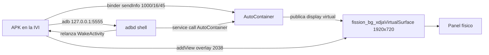

# Tablero propio en un BYD con DiLink 3.0 — guía de implementación para agentes

Documento de trabajo para que un agente de IA (o una persona) pueda reproducir, desde cero, el
tablero personalizado de este repo en una BYD Shark. Todo lo marcado como **medido** se verificó
en esta unidad: `BYD_AUTO`, DiLink 3.0, Android 10, panel de 1920×720. Lo marcado como
**inferencia** es lo que se espera en otras unidades DiLink 3.0 y hay que confirmarlo en el auto.

Referencia ejecutable: `app/` (SharkLab). Contrato de plataforma crudo: `docs/BYD-CONTAINER.md`
y `docs/bug-panel-display.md`. Este documento es el camino recomendado; esos dos son la evidencia.

---

## 0. Modelo mental: tres hechos que gobiernan todo

1. **El cuadro detrás del volante no es un display Android normal.** Es otra instancia del
   sistema (`fission`). La central solo lo controla por el servicio binder `AutoContainer`.
2. **El panel muestra un display virtual** llamado `fission_bg_xdjaVirtualSurface` (1920×720,
   density 320), y ese display **solo existe mientras el container está en modo proyección**.
   `dumpsys display` pasa de 1 a 2 displays cuando el container lo publica.
3. **Cualquier ventana sobre ese display aparece en el panel** mientras el modo proyección esté
   activo. No hace falta capturar la pantalla, ni MediaProjection, ni root para dibujar: hace
   falta una ventana `TYPE_APPLICATION_OVERLAY` creada con el contexto del display del panel.



**Consecuencia de diseño:** el tablero es un WebView (o cualquier View) en una overlay, más un
cliente ADB local que pide los comandos. La app no "transmite" nada; solo dibuja en el display
que el container ya compone.

---

## 1. Paso 0 — confirmar la plataforma antes de escribir código

Requisitos: la central con ADB habilitado (en esta unidad el adbd escucha en `5555`), SDK de
Android (platform + build-tools) y JDK 17 en la máquina de build.

```bash
adb connect <IP-DE-LA-CENTRAL>:5555
adb devices                                   # debe figurar "device", no "unauthorized"

adb shell getprop ro.build.version.release     # 10 en esta unidad
adb shell service list | grep -i AutoContainer
adb shell dumpsys display | grep -E 'fission|mDisplayId'   # 1 display si no hay proyección
adb shell cat /system/etc/container_comm_cfg.json          # paquetes autorizados
adb shell pm list packages | grep -i evsound               # quién más pelea por el panel
```

Esperado en Shark: `AutoContainer: [android.os.IAutoContainer]`, un solo display, y la lista de
`container_comm_cfg.json` incluyendo `com.xdja.clusterdemo`. Si el servicio existe pero tu
paquete no está en la lista, el binder responde `SecurityException: Not allowed package` y el
panel sigue en BYD: renombra el APK o edita la lista (requiere root/sistema).

**Regla:** si `dumpsys display` no muestra `fission_bg_xdjaVirtualSurface`, el panel no está
proyectando y ninguna ventana tuya puede aparecer. Es el estado normal antes de mandar `16`.

---

## 2. Restricciones duras (medidas)

| Restricción | Valor / consecuencia |
|---|---|
| Nombre de paquete | `com.xdja.clusterdemo` es el único autorizado por defecto en `container_comm_cfg.json`. Otro nombre = `SecurityException` y panel en BYD |
| Servicio | `android.os.IAutoContainer` (binder); fallback `com.xdja.autocontainer.IAutoContainer` en algunas builds |
| Canal de comandos | `sendInfo(int type, int cmd, String arg)`, `type = 1000`; `sendJson` devuelve `-1` para todo lo probado |
| Display del panel | nombre `fission_bg_xdjaVirtualSurface`, 1920×720, density 320, `mDisplayId=2` en esta unidad. **Localízalo por nombre, nunca por id** |
| Ventana | `TYPE_APPLICATION_OVERLAY` (2038), `PixelFormat.TRANSLUCENT`, 1920×720, `gravity=TOP|START`, `x=y=0` |
| Contexto | `createDisplayContext(displayDelPanel)`; con el contexto de la Activity la ventana nace en el display 0 (pantalla central) |
| Permiso de overlay | `SYSTEM_ALERT_WINDOW`; si `addView` lanza `SecurityException` es esto. Conceder con `adb shell appops set <pkg> SYSTEM_ALERT_WINDOW allow` |
| Permisos BYD | declarar `android.permission.BYDAUTO_<DEVICE>_COMMON` (los usa la app, no el sistema); ver §3.2 |
| Divisa de "sin lectura" | los getters devuelven `-999`, `8322` o `65535` según el caso; trata todo `< -998` como ausente |

---

## 3. Esqueleto de la app

### 3.1 Manifest mínimo

```xml
<uses-sdk android:minSdkVersion="26" android:targetSdkVersion="26" />
<uses-permission android:name="android.permission.SYSTEM_ALERT_WINDOW" />
<uses-permission android:name="android.permission.INTERNET" />          <!-- socket ADB local -->
<uses-permission android:name="android.permission.FOREGROUND_SERVICE" />
<uses-permission android:name="android.permission.RECEIVE_BOOT_COMPLETED" />
<!-- una por dispositivo BYD que vayas a leer; ejemplos -->
<uses-permission android:name="android.permission.BYDAUTO_SPEED_COMMON" />
<uses-permission android:name="android.permission.BYDAUTO_POWER_COMMON" />
<uses-permission android:name="android.permission.BYDAUTO_TYRE_COMMON" />
```

Declara además:

- `MainActivity` (launcher, `singleTask`) para la interfaz de la central.
- `WakeActivity` con `android:theme="@android:style/Theme.NoDisplay"` y `exported="true"`:
  es la puerta que usa el shell para despertar el proceso sin abrir interfaz.
- `PanelService` `exported="true"` con `foregroundServiceType="mediaProjection"` (o `dataSync`):
  mantiene el proceso vivo y corre el bucle de encendido/apagado. No necesita MediaProjection
  real; el tipo solo evita restricciones de servicio en segundo plano.

### 3.2 Leer datos del carro (API `android.hardware.bydauto.*`)

Las clases del vehículo viven en el sistema, no en tu APK: accede por reflexión.

```java
Class<?> c = Class.forName("android.hardware.bydauto.power.BYDAutoPowerDevice");
Object dev = c.getDeclaredMethod("getInstance", Context.class).invoke(null, ctx);
int pc = (int) dev.getClass().getMethod("getPowerCtlStatus", int.class).invoke(dev, 3);
```

Dos trampas medidas:

1. **El chequeo de `BYDAUTO_*` es del lado del cliente.** El framework evalúa el permiso contra
   el `Context` que le pasas a `getInstance()`. Un `ContextWrapper` que devuelva `GRANTED` solo
   para `android.permission.BYDAUTO_*` hace que los getters funcionen sin firma de plataforma
   (ver `BydPermissionContext.java`). No cambies el resto de los permisos.
2. **El singleton se queda con lecturas viejas.** Recrea el device cada ~1,5 s (o usa un contexto
   nuevo por lectura) o el modo de conducción se queda pegado al anterior.

Además, cada `snapshot()` completo cuesta ~12 ms (37 llamadas al binder). Cachea 120 ms y
comparte la lectura entre todos los consumidores.

### 3.3 Mandar comandos al container (binder, sin shell)

```java
Object binder = Class.forName("android.os.ServiceManager")
        .getMethod("getService", String.class).invoke(null, "AutoContainer");
Object svc = Class.forName("android.os.IAutoContainer$Stub")
        .getMethod("asInterface", android.os.IBinder.class).invoke(null, binder);
svc.getClass().getMethod("sendInfo", int.class, int.class, String.class)
        .invoke(svc, 1000, cmd, "");
```

Equivalente por shell (útil para diagnóstico y para el vigía):

```bash
service call AutoContainer 2 i32 1000 i32 16 s16 null
```

### 3.4 Crear la ventana del tablero

```java
Display panel = null;
for (Display d : ((DisplayManager) ctx.getSystemService(Context.DISPLAY_SERVICE)).getDisplays())
    if (String.valueOf(d.getName()).contains("fission_bg_xdjaVirtualSurface")) panel = d;
if (panel == null) return false;                       // el display aún no existe

Context panelCtx = ctx.createDisplayContext(panel);
WindowManager wm = (WindowManager) panelCtx.getSystemService(Context.WINDOW_SERVICE);
WebView web = new WebView(panelCtx);                   // o cualquier View
WindowManager.LayoutParams lp = new WindowManager.LayoutParams(
        1920, 720,
        WindowManager.LayoutParams.TYPE_APPLICATION_OVERLAY,
        WindowManager.LayoutParams.FLAG_NOT_FOCUSABLE
                | WindowManager.LayoutParams.FLAG_NOT_TOUCHABLE
                | WindowManager.LayoutParams.FLAG_KEEP_SCREEN_ON
                | WindowManager.LayoutParams.FLAG_LAYOUT_IN_SCREEN
                | WindowManager.LayoutParams.FLAG_LAYOUT_NO_LIMITS
                | WindowManager.LayoutParams.FLAG_FULLSCREEN
                | WindowManager.LayoutParams.FLAG_HARDWARE_ACCELERATED,
        PixelFormat.TRANSLUCENT);
lp.gravity = Gravity.TOP | Gravity.START;
lp.x = 0; lp.y = 0;
lp.setTitle("EvSound painel");                          // título observado en la capa del panel
wm.addView(web, lp);
```

Notas medidas:

- La combinación de flags de arriba es la que deja la skin **sin** la barra nativa de BYD
  (P/ECO, batería, autonomía, ODO). Con solo `FLAG_LAYOUT_NO_LIMITS` también se limpió; con
  `NOT_FOCUSABLE|NOT_TOUCHABLE|FULLSCREEN|LAYOUT_IN_SCREEN` el container compone su barra encima.
  Si aparece barra nativa, ajusta flags antes de tocar nada más.
- El título no es el mecanismo (el modo proyección muestra cualquier ventana del display 1); se
  usa el mismo título observado en la capa de referencia para no introducir variables.
- El WebView del panel es una ventana virtual: **`requestAnimationFrame` se congela**. No
  diseñes la skin para animarse sola; empuja el estado desde fuera (§7).

---

## 4. Tomar el panel: la secuencia y sus tiempos

Comandos verificados en esta unidad (`type = 1000`):

| cmd | Efecto observado |
|---|---|
| `16` | el panel empieza a mostrar el display virtual, a pantalla completa, con los widgets nativos encima |
| `17` | mitad |
| `45` | el container deja de dibujar sus widgets: queda solo la skin |
| `46` | recrea el display del panel (necesario si no existe; **mata la ventana actual**) |
| `18` | vuelve al layout original de BYD |
| `0` | suelta |

### Secuencia de toma (medida)

```text
1. display existe y ventana añadida
2. sendInfo(1000, 16)          # proyección
3. sleep 1,5 s
4. sendInfo(1000, 45)          # pantalla completa sin widgets BYD
```

Si el display **no** existe (`panelDisplay == null`):

```text
46 → sleep 1,2–1,8 s → crear ventana → 16 → sleep 1,5 s → 45
```

`46` **nunca** con la ventana viva: recrea el display y deja la ventana huérfana; el panel vuelve
al layout nativo. La implementación de referencia ya no lo usa en la toma normal, solo como
rescate y en el release.

**Reafirmación:** un lazo cada 60 s reenvía `16` y `45` (nunca `46`). Aguanta que otro proceso
mande `18`. Medido: 3 minutos en pantalla completa sin intervención.

**Idempotencia:** no reapliques en ráfaga. `PanelBoot.apply` corta si la última aplicación fue
hace <12 s o si la ventana ya existe; sin eso el tema parpadea 2–3 veces al arrancar.

---

## 5. Devolver el panel (release)

```text
1. ocultar la ventana del tablero        # primero: la BYD enciende el cuadro con la alerta de puerta
2. sendInfo(1000, 46)  → sleep 1,2 s
3. sendInfo(1000, 18)  → sleep 1,0 s
4. sendInfo(1000, 0)
5. marcar "applied=false", "enabled=false" y parar el lazo ADB
```

El orden del paso 1 no es cosmético: con el auto apagado, BYD enciende el cuadro para mostrar
la alerta de puerta abierta y una skin encima la tapa. Si la ventana queda viva, el panel vuelve
a BYD pero el aviso desaparece.

---

## 6. Encendido y apagado del auto

### 6.1 La única señal que sirve

| Lectura | Encendido | Apagado (puerta abierta) |
|---|---|---|
| `power.getPowerCtlStatus(3)` | **1** | **0** |
| `power.getShutdownInfo(1)` | 0 | 0 |
| `bodywork.getAutoSystemState` | 0 | 0 |
| `bodywork.getPowerLevel` | 2 | 0 |
| `power.getMcuStatus` | 1 | 1 |
| `energy.getEnergyState` | 0/1 | 0 |

Regla: `pc == 1` → aplicar; `pc == 0` → `release()`. Se consulta cada 1 s desde el servicio.
`getPowerCtlStatus` solo acepta el índice `3`; los demás devuelven `-2147482645`.

### 6.2 Por qué hace falta un vigía externo

**BYD mata el proceso al apagar.** Los listeners BYD solo entregan eventos si el proceso vive,
`ACTION_SCREEN_OFF` y `ACTION_SHUTDOWN` **no llegan** al apagarse, y `am start-foreground-service`
sobre un paquete parado se rechaza (`Not found; no service started`) aunque el servicio esté
exportado. Por eso:

- un script en el adbd (`/data/local/tmp/…`) vigila cada 2 s y relanza **una activity**
  invisible (`WakeActivity`) cuando no hay proceso;
- `WakeActivity` arranca el `PanelService` y hace `finish()` sin primer cuadro.

No lances la activity principal desde el vigía: abre la interfaz en la central y le roba el
diálogo "¿cargar el coche ahora?" que BYD muestra ~10 s al apagar.

### 6.3 Vigía de referencia

```sh
#!/system/bin/sh
AUTO=/sdcard/Android/data/<pkg>/files/autostart
mkdir /data/local/tmp/wd.lock 2>/dev/null || exit 0
echo $$ > /data/local/tmp/wd.pid
while [ -f "$AUTO" ]; do
  if [ -z "$(pidof <pkg>)" ]; then
    now=$(date +%s); last=$(cat /data/local/tmp/wake.ts 2>/dev/null)
    case "$last" in ''|*[!0-9]*) last=0;; esac
    if [ $((now - last)) -gt 15 ]; then
      date +%s > /data/local/tmp/wake.ts
      am start -n <pkg>/<pkg>.WakeActivity >>/data/local/tmp/wd.log 2>&1
      sleep 8
    fi
  fi
  sleep 2
done
rm -f /data/local/tmp/wd.pid
rmdir /data/local/tmp/wd.lock 2>/dev/null
```

Detalles que costaron una sesión:

- `setsid` para desprenderlo del adbd y **`sleep 1` antes de cerrar la sesión**, o adbd se lleva
  el hijo.
- candado `mkdir` + `pid` para no duplicar vigías; si el pid no existe, borrar el lock huérfano.
- throttle de 15 s en el relanzamiento; sin él, el tema parpadea mientras la app sube.
- el archivo `autostart` existe **solo** si el usuario activó "iniciar automáticamente": es el
  interruptor del vigía. Sin ese archivo, la app no revive al encender.
- se arma en cada APLICAR y se rearma cada 60 s desde el bucle de la app.

### 6.4 Apagado visto desde dentro

Además del bucle de `pc`, el `PanelService` registra `SCREEN_OFF`, `ACTION_SHUTDOWN` y
`QUICKBOOT_POWEROFF` (el receptor del manifest no recibe broadcasts implícitos en Android 8+), y
la ventana del panel escucha `DisplayManager` para soltar cuando el display del panel pasa a
`STATE_OFF`/`DOZE`. El apagado del auto no emite esos broadcasts medidos; valen para el sueño de
la central y como tercera red. La señal que decide es `pc`.

---

## 7. Contrato de la skin

La skin es un HTML/SVG autónomo dentro del APK (`assets/dash/<id>/index.html`) o en
`/sdcard/Android/data/<pkg>/files/dash/<id>/`.

### 7.1 Geometría y viewport

- Lienzo real: **1920×720** px, density 320 → viewport CSS de **960 px** de ancho. Usa un SVG
  con proporción 8:3 (`viewBox="0 0 1280 480"` en el tema de referencia, o `0 0 1920 720`) y
  `width/height="100%"`: escala solo. No metas `setInitialScale` ni zoom: un valor mal elegido
  recorta la skin.
- Mantén el contenido crítico lejos de los bordes (aros a x≈300/1620, y≈400 en la referencia) y
  deja una franja superior limpia si algún día el panel vuelve a componer widgets nativos.

### 7.2 Datos: un solo contrato

El app llama, cada 400 ms:

```js
window.__pushedByApp = 1;
window.BrasaDriveUpdate({ /* estado plano */ });
```

La página **no** debe leer el carro por su cuenta cuando `__pushedByApp` está en 1: duplicaría
las 37 lecturas del binder por ciclo y dejaría la thread del renderer ocupada. Si tu skin trae
el `lab-feed.js` de referencia, ya respeta esa bandera.

Campos de referencia (`PanelBridge.state()`, valores enteros; `-999` = sin lectura):

| Campo | Significado |
|---|---|
| `speed`, `gsel`, `reverse` | km/h; marcha cruda (0 N, 1 R, 2 D, 3 P, 4 N); reversa |
| `ped`, `load`, `brk` | pedal 0–100; carga 0–1; freno |
| `soc`, `range`, `fuel`, `fuelKm` | batería %; autonomía eléctrica; combustible %; autonomía térmica |
| `pw`, `odo`, `tout`, `v12` | potencia kW; odómetro; temperatura exterior; tensión 12 V |
| `pu`, `du`, `su` | unidades del panel: 1 métrico, 2 imperial (kW/hp, km/mi, km/h/mph) |
| `drive`, `surfmode`, `ecoind` | modo de terreno (`getRoadSurfaceMode`: 1 montaña, 2 nieve, 3 lodo, 4 arena, 5 normal); testigo ECO |
| `tyre` | `{fl,fr,rl,rr}` en **bar** (el carro devuelve kPa; divide por 100 si >20) |
| `adas`, `warn`, `cv`, `nmv` | ADAS por radar, avisos, cámaras, navegación (opcionales) |

Reglas de datos medidas: el pedal puede venir en 0–255 (normaliza si >100); el odómetro total
puede requerir EV+HEV; las presiones llegan en kPa; los valores de modo en el arranque pueden ser
`8322`/`65535` y hay que sostener el último válido durante ~15 s.

### 7.3 Fluidez

- Empuja a 2,5 Hz (400 ms). Cada lectura completa son ~12 ms de binder.
- La página del panel no puede medir su propio `requestAnimationFrame` (ventana virtual
  congelada). Mide con SurfaceFlinger:

```bash
./tools/panel-fps.sh <IP>:5555
adb shell dumpsys SurfaceFlinger --list | grep -i 'painel\|cluster\|sharklab'
```

- Para depurar dentro del WebView: `WebView.setWebContentsDebuggingEnabled(true)` **antes** del
  primer WebView del proceso, luego
  `adb forward tcp:9222 localabstract:webview_devtools_remote_<pid>` y `chrome://inspect`.

---

## 8. Compilar e instalar (sin Gradle)

```bash
SDK=/opt/android-sdk ./app/build.sh          # sale en app/out/sharklab-cluster.apk
adb install -r app/out/sharklab-cluster.apk
adb shell appops set com.xdja.clusterdemo SYSTEM_ALERT_WINDOW allow
```

- El APK sale con `--rename-manifest-package com.xdja.clusterdemo`; es lo que autoriza el
  container. Con otro nombre la skin se dibuja pero el panel no la muestra.
- La clave ADB de la estación se embute en `build/assets/adbkey.pem`/`.pub` (fuera del git) si
  existe `~/.android/adbkey`. En el auto, autoriza una vez; después la conexión a `127.0.0.1:5555`
  entra sin diálogo.
- La firma es propia (`app/lab.keystore`); reinstalar con la misma firma o desinstalar antes.
- **Revisa la lista de auto-inicio de BYD después de cada instalación**: es una lista negra con
  los interruptores invertidos y se indexa por directorio del APK (fila en OFF = habilitado).

---

## 9. Diagnóstico: síntoma → causa

```bash
adb -s <IP>:5555 shell dumpsys display | grep -c fission        # 0 = display del panel no existe
adb -s <IP>:5555 shell pidof com.xdja.clusterdemo               # vacío = nadie despertó la app
adb -s <IP>:5555 shell dumpsys window windows | grep -i painel  # ventana viva?
adb -s <IP>:5555 exec-out fission_screencap -d 0 > panel.raw    # captura del panel
adb -s <IP>:5555 shell tail -20 /data/local/tmp/shark.log
adb -s <IP>:5555 shell tail -20 /sdcard/Android/data/com.xdja.clusterdemo/files/painel.log
```

| Síntoma | Causa probable | Acción |
|---|---|---|
| Panel en BYD, `fission` = 0 | modo proyección nunca entró | manda `16` (o `46`→`16` si el display no existe) |
| `fission` > 0, `pidof` vacío | nadie despertó la app | revisa vigía, lock, `autostart` y lista de auto-inicio |
| `fission` > 0, pid vivo, sin ventana | `addView` falló | mira `painel.log`: `display do painel nao encontrado` o `SecurityException` de overlay |
| Panel negro con iconos BYD encima | ventana creada antes de que existiera el display | `46`, espera, recrea ventana, `16`, `45` |
| Skin ampliada y cortada | zoom/viewport del WebView | quita `setInitialScale`, deja `viewBox` 1920×720 y `100%` |
| Skin azul aparece naranja en la captura | decodificaste RGBA como BGRA | el capture es **RGBA**; el panel real estaba bien |
| Panel vuelve solo a BYD | otro proceso mandó `18` (EvSound) | desinstala/para el EvSound; el lazo de 60 s retoma |
| Skin cubre la alerta de puerta | se soltó después de ocultar la ventana | oculta la ventana **antes** de `46/18/0` |

Captura del panel: `fission_screencap` devuelve 4 bytes por píxel y una cabecera de tamaño
variable según la build (8 o 16 bytes: `w, h[, format, stride]`). No asumas el offset: prueba
ambos y compara un color conocido. Canales en orden **RGBA**, no BGRA.

---

## 10. Camino cerrado: lo que se probó y NO funciona

No repitas estas rutas; están medidas en esta unidad.

| Intento | Resultado |
|---|---|
| Crear un `VirtualDisplay` privado con el nombre `shared_fission_bg_XDJAScreenProjection_0` | renderiza y se captura, pero el clúster no lo muestra: falta el attach privilegiado |
| `sendJson(1000, …)` con cualquier payload (`{"auto_container":true}`, nombres de display) | siempre `-1` |
| `registerCallback(IContainerCallback)` desde app/shell | mata el proceso |
| `VIRTUAL_DISPLAY_FLAG_PUBLIC` | `SecurityException` (exige `CAPTURE_VIDEO_OUTPUT`) |
| `ACTION_SCREEN_OFF` / `ACTION_SHUTDOWN` en el manifest | no llegan al apagar |
| `power.getShutdownInfo(1)`, `bodywork.getAutoSystemState/getPowerLevel`, `power.getMcuStatus` | iguales encendido y apagado: no sirven como señal |
| Latido en archivo con ventana de 12 s | funcionaba pero es más lento y menos fiable que `pc` |
| `am start-foreground-service` sobre paquete parado | `Not found; no service started`; usa `am start` de la activity |
| Correr junto al EvSound | los dos mandan 16/18 al mismo container y la skin desaparece; desinstálalo o páralo |

---

## 11. Portar a otra BYD con DiLink 3.0

Lo único específico de la Shark en este diseño es el **nombre del display** y los códigos de
comando. Verifica en la unidad nueva, en este orden:

1. `service list | grep AutoContainer` → si el binder no existe, la unidad no expone el panel.
2. `cat /system/etc/container_comm_cfg.json` → tu paquete (o el nombre que debas usar).
3. `dumpsys display` con proyección activa → nombre y tamaño real del display del panel
   (busca `type VIRTUAL`, `FLAG_PRESENTATION`). Ajusta el `contains(...)` y el `1920×720`.
4. Barrido de comandos con reversión segura:

```bash
for c in 16 45 17 46 18; do
  service call AutoContainer 2 i32 1000 i32 $c s16 null
  sleep 1.5
  fission_screencap -d 0 > "/data/local/tmp/c$c.raw"
  service call AutoContainer 2 i32 1000 i32 18 s16 null
  sleep 1
done
```

5. Repite la medición de encendido/apagado (§6.1) antes de confiar en `getPowerCtlStatus(3)`:
   otras carrocerías pueden exponer la señal en otro índice o clase.
6. Revisa si otra app de la unidad ya pelea por el panel (EvSound u otra): dos dueños = panel
   inestable.

Si `45` no existe o pinta negro en la unidad nueva, el fallback es `16` solo: la skin aparece a
pantalla completa con los widgets nativos encima. No es aceptable como entrega final, pero
mantiene el tablero usable mientras adaptas el código.

**Inferencia, no medido:** que `45`, `46` y el nombre del display sean idénticos en todo DiLink
3.0. Son plausibles por compartir la misma base, pero cada modelo (Seal, Song, Dolphin…) debe
confirmarlos con el barrido de arriba.

---

## 12. Checklist de aceptación (en el auto, no en el emulador)

1. APK instalado con el paquete autorizado; `SYSTEM_ALERT_WINDOW` concedido.
2. APLICAR: ventana creada → `16` → `45`; el panel queda solo con la skin, sin barra BYD.
3. La skin se actualiza sin tocar la pantalla central (velocidad, pedal, batería, marcha).
4. DESACTIVAR: el panel vuelve a BYD en ≤2 s y la ventana desaparece.
5. Apagar el auto y abrir la puerta: se ve la alerta de puerta, **sin** skin encima.
6. Encender normal: con "iniciar automáticamente" ON, la skin vuelve en ≤5 s sin abrir la app.
7. Encender remoto (app BYD): mismo resultado, sin diálogos ni interfaz en la central.
8. `am kill <pkg>` con el auto encendido: el vigía relanza la app y el panel se recupera.
9. Dejar 3 minutos sin tocar: el panel sigue en pantalla completa (reafirmación de 60 s).
10. `./tools/panel-fps.sh`: sin jank sostenido; fps cercano al vsync.
11. Revisar `painel.log`: sin `display do painel nao encontrado` ni `SecurityException`.
12. Reiniciar la central: el estado "aplicado" no revive solo si el toggle está apagado.

---

## 13. Mapa del código de referencia

| Archivo | Responsabilidad |
|---|---|
| `PanelBoot.java` | aplica en arranque sin abrir la central: ventana → `16` → `45`, con idempotencia |
| `ClusterOverlay.java` | ventana del panel, flags, display listener, push de estado a 400 ms |
| `PanelRelease.java` | oculta la ventana y devuelve el panel (`46`→`18`→`0`); bandera de sesión |
| `PanelService.java` | proceso vivo, receptor `SCREEN_OFF`, bucle de `powerCtlStatus` cada 1 s |
| `AdbShell.java` | cliente ADB local, canal de comandos, script del vigía, rastro en archivo |
| `WakeActivity.java` | activity invisible que arranca el servicio y termina |
| `BootReceiver.java` | decisión de arranque según el toggle y `PowerManager.isInteractive()` |
| `BydBridge.java` / `BydPermissionContext.java` | lectura por reflexión y bypass del chequeo cliente |
| `ClusterSkinActivity.java` | `PanelBridge`: contrato JSON de la skin y unidades |
| `themes/dash/byd/index.html` | skin 8:3 (`viewBox` 1280×480), transparencias y `BrasaDriveUpdate` |

---

## 14. Reglas de oro

1. Localiza el display **por nombre**, nunca por id ni por índice.
2. `16` antes de `45`; `46` solo si el display no existe o al soltar.
3. Ventana primero en la toma normal (sin ventana, `45` muestra el layout nativo); pero si el
   display aún no existe, `46` y espera antes de crearla.
4. Al soltar, oculta la ventana antes de devolver el panel.
5. Una sola app puede mandar comandos al container. Si hay otra, desinstálala o despáchala.
6. No confíes en eventos: `pc`, pantalla y display se vigilan por sondeo.
7. Todo lo que no esté medido en el auto, no está implementado.
