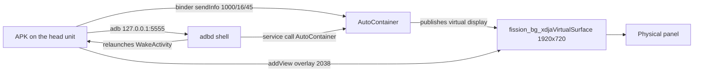

# Own dashboard on a BYD with DiLink 3.0 — implementation guide for agents

Working document so that an AI agent (or a person) can reproduce, from scratch, a custom cluster
dashboard on a BYD with DiLink 3.0. Everything marked as **measured** was verified on one unit:
a BYD Shark (`BYD_AUTO`, DiLink 3.0, Android 10, 1920×720 panel). Everything marked as
**inference** is what is expected on other DiLink 3.0 units and has to be confirmed on the car
before claiming support.

Other BYD models are expected to work when they share the same cluster system (the
`AutoContainer` binder and the `fission` virtual display). Porting means re-measuring the panel
display name, the command codes and the power signal; §11 lists the probes. Contributions that
add support for another model are welcome, with the measured values attached.

Executable reference: `app/` (SharkLab). Raw platform contract: `docs/BYD-CONTAINER.md` and
`docs/bug-panel-display.md`. This document is the recommended path; those two are the evidence.

---

## 0. Mental model: three facts that govern everything

1. **The display behind the steering wheel is not a normal Android display.** It is another
   instance of the system (`fission`). The head unit only controls it through the `AutoContainer`
   binder service.
2. **The panel shows a virtual display** named `fission_bg_xdjaVirtualSurface` (1920×720,
   density 320), and that display **only exists while the container is in projection mode**.
   `dumpsys display` goes from 1 to 2 displays when the container publishes it.
3. **Any window on that display appears on the panel** while projection mode is active. You do
   not need screen capture, MediaProjection or root to draw: you need a
   `TYPE_APPLICATION_OVERLAY` window created with the context of the panel display.



**Design consequence:** the dashboard is a WebView (or any View) inside an overlay, plus a local
ADB client that sends the commands. The app does not "transmit" anything; it only draws on the
display the container already composites.

---

## 1. Step 0 — confirm the platform before writing code

Requirements: the head unit with ADB enabled (on this unit adbd listens on `5555`), the Android
SDK (platform + build-tools) and JDK 17 on the build machine.

```bash
adb connect <HEAD-UNIT-IP>:5555
adb devices                                   # it must show "device", not "unauthorized"

adb shell getprop ro.build.version.release     # 10 on this unit
adb shell service list | grep -i AutoContainer
adb shell dumpsys display | grep -E 'fission|mDisplayId'   # 1 display if there is no projection
adb shell cat /system/etc/container_comm_cfg.json          # authorised packages
adb shell pm list packages | grep -i clusterdemo           # our app installed?
```

Expected on a Shark: `AutoContainer: [android.os.IAutoContainer]`, a single display, and the
`container_comm_cfg.json` list including `com.xdja.clusterdemo`. If the service exists but your
package is not in the list, the binder answers `SecurityException: Not allowed package` and the
panel stays on BYD: rename the APK or edit the list (needs root/system).

**Rule:** if `dumpsys display` does not show `fission_bg_xdjaVirtualSurface`, the panel is not
projecting and no window of yours can appear. That is the normal state before sending `16`.

Once projection is on, the layers on the panel tell you who is competing for it:

```bash
adb shell dumpsys SurfaceFlinger --list | grep -i -E 'painel|cluster'
```

---

## ADB command reference

Everything a newcomer needs, in one place. `<IP>` = head unit address, `com.xdja.clusterdemo` =
the authorised package name (copy it exactly; another name gets `SecurityException`).

| Goal | Command | Expected |
|---|---|---|
| Connect | `adb connect <IP>:5555` | `connected to <IP>:5555` |
| List devices | `adb devices` | a row with `device` (not `unauthorized`) |
| Build | `SDK=/opt/android-sdk ./app/build.sh` | `app/out/sharklab-cluster.apk` |
| Install | `adb install -r app/out/sharklab-cluster.apk` | `Success` |
| Overlay permission | `adb shell appops set com.xdja.clusterdemo SYSTEM_ALERT_WINDOW allow` | no output |
| Panel commands | `adb shell service call AutoContainer 2 i32 1000 i32 <cmd> s16 null` | `Result: Parcel(...)` with 0 |
| Displays | `adb shell dumpsys display` | `fission_bg_xdjaVirtualSurface` when projecting |
| Windows | `adb shell dumpsys window windows` | the skin window (grep `painel`) |
| Layers | `adb shell dumpsys SurfaceFlinger --list` | the panel layer (grep `painel`) |
| Panel capture | `adb exec-out fission_screencap -d 0 > panel.raw` | RGBA 1920×720 + header |
| App log | `adb shell tail -20 /sdcard/Android/data/com.xdja.clusterdemo/files/panel.log` | app traces |
| Watchdog log | `adb shell tail -20 /data/local/tmp/shark.log` | `armed` / `relaunching` / `am rc=0` |
| App alive? | `adb shell pidof com.xdja.clusterdemo` | pid, or empty when dead |
| Watchdog alive? | `adb shell cat /data/local/tmp/shark_wd.pid` | pid of the adbd script |

Panel command codes: `16` projection, `17` half, `18` back to BYD, `45` full screen without the
BYD widgets, `46` recreate the panel display, `0` release.

Raw block, in the order you normally need it:

```bash
adb connect <IP>:5555
adb devices
adb install -r app/out/sharklab-cluster.apk
adb shell appops set com.xdja.clusterdemo SYSTEM_ALERT_WINDOW allow

adb shell service call AutoContainer 2 i32 1000 i32 16 s16 null     # projection
adb shell service call AutoContainer 2 i32 1000 i32 45 s16 null     # drop BYD widgets
adb shell service call AutoContainer 2 i32 1000 i32 46 s16 null     # recreate the display (kills the window)
adb shell service call AutoContainer 2 i32 1000 i32 18 s16 null     # back to BYD
adb shell service call AutoContainer 2 i32 1000 i32 0  s16 null     # release

adb shell dumpsys display | grep -c fission
adb shell dumpsys window windows | grep -i painel
adb shell dumpsys SurfaceFlinger --list | grep -i painel
adb exec-out fission_screencap -d 0 > panel.raw

adb shell pidof com.xdja.clusterdemo
adb shell cat /data/local/tmp/shark_wd.pid
adb shell tail -20 /data/local/tmp/shark.log
adb shell tail -20 /sdcard/Android/data/com.xdja.clusterdemo/files/panel.log
```

---

## 2. Hard constraints (measured)

| Constraint | Value / consequence |
|---|---|
| Package name | `com.xdja.clusterdemo` is the only one authorised by default in `container_comm_cfg.json`. Another name = `SecurityException` and panel on BYD |
| Service | `android.os.IAutoContainer` (binder); fallback `com.xdja.autocontainer.IAutoContainer` on some builds |
| Command channel | `sendInfo(int type, int cmd, String arg)`, `type = 1000`; `sendJson` returns `-1` for everything tried |
| Panel display | name `fission_bg_xdjaVirtualSurface`, 1920×720, density 320, `mDisplayId=2` on this unit. **Find it by name, never by id** |
| Window | `TYPE_APPLICATION_OVERLAY` (2038), `PixelFormat.TRANSLUCENT`, 1920×720, `gravity=TOP\|START`, `x=y=0` |
| Context | `createDisplayContext(panelDisplay)`; with the Activity context the window is born on display 0 (head unit screen) |
| Overlay permission | `SYSTEM_ALERT_WINDOW`; if `addView` throws `SecurityException` it is this. Grant it with `adb shell appops set <pkg> SYSTEM_ALERT_WINDOW allow` |
| BYD permissions | declare `android.permission.BYDAUTO_<DEVICE>_COMMON` (the app uses them, not the system); see §3.2 |
| "No reading" sentinel | the getters return `-999`, `8322` or `65535` depending on the case; treat anything `< -998` as absent |

---

## 3. App skeleton

### 3.1 Minimal manifest

```xml
<uses-sdk android:minSdkVersion="26" android:targetSdkVersion="26" />
<uses-permission android:name="android.permission.SYSTEM_ALERT_WINDOW" />
<uses-permission android:name="android.permission.INTERNET" />          <!-- local ADB socket -->
<uses-permission android:name="android.permission.FOREGROUND_SERVICE" />
<uses-permission android:name="android.permission.RECEIVE_BOOT_COMPLETED" />
<!-- one per BYD device you are going to read; examples -->
<uses-permission android:name="android.permission.BYDAUTO_SPEED_COMMON" />
<uses-permission android:name="android.permission.BYDAUTO_POWER_COMMON" />
<uses-permission android:name="android.permission.BYDAUTO_TYRE_COMMON" />
```

Also declare:

- `MainActivity` (launcher, `singleTask`) for the head unit interface.
- `WakeActivity` with `android:theme="@android:style/Theme.NoDisplay"` and `exported="true"`:
  it is the door the shell uses to wake the process without opening an interface.
- `PanelService` `exported="true"` with `foregroundServiceType="mediaProjection"` (or `dataSync`):
  it keeps the process alive and runs the on/off loop. It does not need a real MediaProjection;
  the type only avoids background service restrictions.

### 3.2 Reading car data (API `android.hardware.bydauto.*`)

The vehicle classes live in the system, not in your APK: reach them through reflection.

```java
Class<?> c = Class.forName("android.hardware.bydauto.power.BYDAutoPowerDevice");
Object dev = c.getDeclaredMethod("getInstance", Context.class).invoke(null, ctx);
int pc = (int) dev.getClass().getMethod("getPowerCtlStatus", int.class).invoke(dev, 3);
```

Two measured traps:

1. **The `BYDAUTO_*` check is on the client side.** The framework evaluates the permission against
   the `Context` you pass to `getInstance()`. A `ContextWrapper` that returns `GRANTED` only for
   `android.permission.BYDAUTO_*` makes the getters work without a platform signature (see
   `BydPermissionContext.java`). Do not change the rest of the permissions.
2. **The singleton keeps stale readings.** Recreate the device every ~1.5 s (or use a new context
   per read) or the driving mode sticks to the previous one.

Also, a full `snapshot()` costs ~12 ms (37 binder calls). Cache for 120 ms and share the read
between all consumers.

### 3.3 Sending commands to the container (binder, no shell)

```java
Object binder = Class.forName("android.os.ServiceManager")
        .getMethod("getService", String.class).invoke(null, "AutoContainer");
Object svc = Class.forName("android.os.IAutoContainer$Stub")
        .getMethod("asInterface", android.os.IBinder.class).invoke(null, binder);
svc.getClass().getMethod("sendInfo", int.class, int.class, String.class)
        .invoke(svc, 1000, cmd, "");
```

Equivalent through the shell (useful for diagnostics and for the watchdog):

```bash
service call AutoContainer 2 i32 1000 i32 16 s16 null
```

### 3.4 Creating the dashboard window

```java
Display panel = null;
for (Display d : ((DisplayManager) ctx.getSystemService(Context.DISPLAY_SERVICE)).getDisplays())
    if (String.valueOf(d.getName()).contains("fission_bg_xdjaVirtualSurface")) panel = d;
if (panel == null) return false;                       // the display does not exist yet

Context panelCtx = ctx.createDisplayContext(panel);
WindowManager wm = (WindowManager) panelCtx.getSystemService(Context.WINDOW_SERVICE);
WebView web = new WebView(panelCtx);                   // or any View
WindowManager.LayoutParams lp = new WindowManager.LayoutParams(
        1920, 720,
        WindowManager.LayoutParams.TYPE_APPLICATION_OVERLAY,
        WindowManager.LayoutParams.FLAG_NOT_FOCUSABLE
                | WindowManager.LayoutParams.FLAG_NOT_TOUCHABLE
                | WindowManager.LayoutParams.FLAG_KEEP_SCREEN_ON
                | WindowManager.LayoutParams.FLAG_LAYOUT_IN_SCREEN
                | WindowManager.LayoutParams.FLAG_LAYOUT_NO_LIMITS
                | WindowManager.LayoutParams.FLAG_FULLSCREEN
                | WindowManager.LayoutParams.FLAG_HARDWARE_ACCELERATED,
        PixelFormat.TRANSLUCENT);
lp.gravity = Gravity.TOP | Gravity.START;
lp.x = 0; lp.y = 0;
lp.setTitle(ClusterOverlay.WINDOW_TITLE);              // fixed literal — see the note below
wm.addView(web, lp);
```

Measured notes:

- The flag combination above is the one that leaves the skin **without** the native BYD bar
  (P/ECO, battery, range, ODO). With only `FLAG_LAYOUT_NO_LIMITS` it was also clean; with
  `NOT_FOCUSABLE|NOT_TOUCHABLE|FULLSCREEN|LAYOUT_IN_SCREEN` the container composites its bar on
  top. If the native bar shows up, adjust flags before touching anything else.
- The window title is **not** the mechanism: while projection mode is active the container shows
  any window on the panel display. The literal is copied from the layer observed on the reference
  app, defined once as `ClusterOverlay.WINDOW_TITLE`, so the layer is easy to find in `dumpsys`
  (`grep -i painel`). Changing it does not break the projection, but keep it consistent with the
  tooling.
- The panel WebView is a virtual window: **`requestAnimationFrame` freezes**. Do not design the
  skin to animate by itself; push the state from outside (§7).

---

## 4. Taking the panel: the sequence and its timings

Commands verified on this unit (`type = 1000`):

| cmd | Observed effect |
|---|---|
| `16` | the panel starts showing the virtual display, full screen, with the native widgets on top |
| `17` | half |
| `45` | the container stops drawing its widgets: only the skin is left |
| `46` | recreates the panel display (needed when it does not exist; **kills the current window**) |
| `18` | back to the original BYD layout |
| `0` | release |

### Take sequence (measured)

```text
1. display exists and window added
2. sendInfo(1000, 16)          # projection
3. sleep 1.5 s
4. sendInfo(1000, 45)          # full screen without BYD widgets
```

If the display does **not** exist (`panelDisplay == null`):

```text
46 → sleep 1.2–1.8 s → create window → 16 → sleep 1.5 s → 45
```

`46` **never** with the window alive: it recreates the display and leaves the window orphaned;
the panel goes back to the native layout. The reference implementation no longer uses it on the
normal take, only as a rescue and on release.

**Reaffirmation:** a loop every 60 s resends `16` and `45` (never `46`). It survives another
process sending `18`. Measured: 3 minutes full screen without intervention.

**Idempotence:** do not reapply in a burst. `PanelBoot.apply` bails out if the last application
was <12 s ago or if the window already exists; without that the theme flickers 2–3 times at boot.

---

## 5. Giving the panel back (release)

```text
1. hide the dashboard window              # first: BYD turns the cluster on with the door alert
2. sendInfo(1000, 46)  → sleep 1.2 s
3. sendInfo(1000, 18)  → sleep 1.0 s
4. sendInfo(1000, 0)
5. mark "applied=false", "enabled=false" and stop the ADB loop
```

The order of step 1 is not cosmetic: with the car off, BYD turns the cluster display on to show
the open-door alert and a skin on top of it covers it. If the window stays alive, the panel goes
back to BYD but the warning disappears.

---

## 6. Car on and off

### 6.1 The only signal that works

| Reading | On | Off (door open) |
|---|---|---|
| `power.getPowerCtlStatus(3)` | **1** | **0** |
| `power.getShutdownInfo(1)` | 0 | 0 |
| `bodywork.getAutoSystemState` | 0 | 0 |
| `bodywork.getPowerLevel` | 2 | 0 |
| `power.getMcuStatus` | 1 | 1 |
| `energy.getEnergyState` | 0/1 | 0 |

Rule: `pc == 1` → apply; `pc == 0` → `release()`. Polled every 1 s from the service.
`getPowerCtlStatus` only accepts index `3`; the others return `-2147482645`.

### 6.2 Why an external watchdog is needed

**BYD kills the process on shut-down.** BYD listeners only deliver events if the process is
alive, `ACTION_SCREEN_OFF` and `ACTION_SHUTDOWN` **do not arrive** on shut-down, and
`am start-foreground-service` on a stopped package is refused (`Not found; no service started`)
even when the service is exported. Therefore:

- a script in adbd (`/data/local/tmp/…`) watches every 2 s and relaunches an **invisible
  activity** (`WakeActivity`) when there is no process;
- `WakeActivity` starts `PanelService` and calls `finish()` without a first frame.

Do not launch the main activity from the watchdog: it opens the interface on the head unit and
steals the "load the car now?" dialog that BYD shows for ~10 s when shutting down.

### 6.3 Reference watchdog

```sh
#!/system/bin/sh
AUTO=/sdcard/Android/data/<pkg>/files/autostart
mkdir /data/local/tmp/wd.lock 2>/dev/null || exit 0
echo $$ > /data/local/tmp/wd.pid
while [ -f "$AUTO" ]; do
  if [ -z "$(pidof <pkg>)" ]; then
    now=$(date +%s); last=$(cat /data/local/tmp/wake.ts 2>/dev/null)
    case "$last" in ''|*[!0-9]*) last=0;; esac
    if [ $((now - last)) -gt 15 ]; then
      date +%s > /data/local/tmp/wake.ts
      am start -n <pkg>/<pkg>.WakeActivity >>/data/local/tmp/wd.log 2>&1
      sleep 8
    fi
  fi
  sleep 2
done
rm -f /data/local/tmp/wd.pid
rmdir /data/local/tmp/wd.lock 2>/dev/null
```

Details that cost a session:

- `setsid` to detach it from adbd and **`sleep 1` before closing the session**, or adbd takes the
  child away.
- `mkdir` lock + `pid` so you do not duplicate watchdogs; if the pid does not exist, delete the
  orphan lock.
- 15 s throttle on the relaunch; without it the theme flickers while the app comes up.
- the `autostart` file exists **only** if the user enabled "start automatically": it is the
  watchdog switch. Without that file, the app does not come back on power-on.
- it is armed on every `APLICAR` and re-armed every 60 s from the app loop.

### 6.4 Shut-down seen from the inside

Besides the `pc` loop, `PanelService` registers `SCREEN_OFF`, `ACTION_SHUTDOWN` and
`QUICKBOOT_POWEROFF` (the manifest receiver does not receive implicit broadcasts on Android 8+),
and the panel window listens to `DisplayManager` to release when the panel display goes to
`STATE_OFF`/`DOZE`. The car shut-down does not emit those broadcasts as measured; they are worth
it for the head unit going to sleep and as a third net. The deciding signal is `pc`.

---

## 7. Skin contract

The skin is a self-contained HTML/SVG inside the APK (`assets/dash/<id>/index.html`) or in
`/sdcard/Android/data/<pkg>/files/dash/<id>/`.

### 7.1 Geometry and viewport

- Real canvas: **1920×720** px, density 320 → CSS viewport **960 px** wide. Use an SVG with an
  8:3 ratio (`viewBox="0 0 1280 480"` in the reference theme, or `0 0 1920 720`) and
  `width/height="100%"`: it scales by itself. Do not set `setInitialScale` or zoom: a badly
  chosen value crops the skin.
- Keep the critical content away from the edges (rings at x≈300/1620, y≈400 in the reference)
  and leave a clean top strip in case the panel ever composites native widgets again.

### 7.2 Data: a single contract

The app calls, every 400 ms:

```js
window.__pushedByApp = 1;
window.BrasaDriveUpdate({ /* flat state */ });
```

The page must **not** read the car by itself when `__pushedByApp` is 1: it would duplicate the 37
binder reads per cycle and leave the renderer thread busy. If your skin brings the reference
`lab-feed.js`, it already respects that flag.

Reference fields (`PanelBridge.state()`, integer values; `-999` = no reading):

| Field | Meaning |
|---|---|
| `speed`, `gsel`, `reverse` | km/h; raw gear (0 N, 1 R, 2 D, 3 P, 4 N); reverse |
| `ped`, `load`, `brk` | pedal 0–100; load 0–1; brake |
| `soc`, `range`, `fuel`, `fuelKm` | battery %; electric range; fuel %; combustion range |
| `pw`, `odo`, `tout`, `v12` | power kW; odometer; outside temperature; 12 V voltage |
| `pu`, `du`, `su` | panel units: 1 metric, 2 imperial (kW/hp, km/mi, km/h/mph) |
| `drive`, `surfmode`, `ecoind` | terrain mode (`getRoadSurfaceMode`: 1 mountain, 2 snow, 3 mud, 4 sand, 5 normal); ECO telltale |
| `tyre` | `{fl,fr,rl,rr}` in **bar** (the car returns kPa; divide by 100 if >20) |
| `adas`, `warn`, `cv`, `nmv` | radar ADAS, warnings, cameras, navigation (optional) |

Measured data rules: the pedal may come as 0–255 (normalise if >100); the total odometer may
need EV+HEV; pressures arrive in kPa; the mode values at boot may be `8322`/`65535` and the last
valid one has to be held for ~15 s.

### 7.3 Smoothness

- Push at 2.5 Hz (400 ms). Each full read is ~12 ms of binder.
- The panel page cannot measure its own `requestAnimationFrame` (virtual window frozen). Measure
  with SurfaceFlinger:

```bash
./tools/panel-fps.sh <IP>:5555
adb shell dumpsys SurfaceFlinger --list | grep -i 'painel\|cluster\|sharklab'
```

- To debug inside the WebView: `WebView.setWebContentsDebuggingEnabled(true)` **before** the
  first WebView of the process, then
  `adb forward tcp:9222 localabstract:webview_devtools_remote_<pid>` and `chrome://inspect`.

---

## 8. Build and install (no Gradle)

```bash
SDK=/opt/android-sdk ./app/build.sh          # lands in app/out/sharklab-cluster.apk
adb install -r app/out/sharklab-cluster.apk
adb shell appops set com.xdja.clusterdemo SYSTEM_ALERT_WINDOW allow
```

- The APK is built with `--rename-manifest-package com.xdja.clusterdemo`; that is what authorises
  it with the container. Under another name the skin is drawn but the panel does not show it.
- The workstation ADB key is embedded in `build/assets/adbkey.pem`/`.pub` (outside git) if
  `~/.android/adbkey` exists. On the car, authorise once; after that the connection to
  `127.0.0.1:5555` goes through without a dialog.
- The signature is our own (`app/lab.keystore`); reinstall with the same signature or uninstall
  first.
- **Check the BYD auto-start list after every installation**: it is a blocklist with the switches
  inverted and it is indexed by APK directory (row OFF = enabled).

---

## 9. Diagnostics: symptom → cause

```bash
adb -s <IP>:5555 shell dumpsys display | grep -c fission        # 0 = panel display does not exist
adb -s <IP>:5555 shell pidof com.xdja.clusterdemo               # empty = nobody woke the app
adb -s <IP>:5555 shell dumpsys window windows | grep -i painel  # window alive?
adb -s <IP>:5555 exec-out fission_screencap -d 0 > panel.raw    # panel capture
adb -s <IP>:5555 shell tail -20 /data/local/tmp/shark.log
adb -s <IP>:5555 shell tail -20 /sdcard/Android/data/com.xdja.clusterdemo/files/panel.log
```

| Symptom | Probable cause | Action |
|---|---|---|
| Panel on BYD, `fission` = 0 | projection mode never entered | send `16` (or `46`→`16` if the display does not exist) |
| `fission` > 0, `pidof` empty | nobody woke the app | check the watchdog, lock, `autostart` and the auto-start list |
| `fission` > 0, pid alive, no window | `addView` failed | look at `panel.log`: `panel display not found` or an overlay `SecurityException` |
| Black panel with BYD icons on top | window created before the display existed | `46`, wait, recreate the window, `16`, `45` |
| Skin enlarged and cropped | WebView zoom/viewport | remove `setInitialScale`, keep a 1920×720 `viewBox` and `100%` |
| Blue skin shows up orange in the capture | you decoded RGBA as BGRA | the capture is **RGBA**; the real panel was fine |
| Panel goes back to BYD on its own | another process sent `18` (the reference cluster app) | uninstall/stop the reference app; the 60 s loop retakes it |
| Skin covers the door alert | released after hiding the window | hide the window **before** `46/18/0` |

Panel capture: `fission_screencap` returns 4 bytes per pixel and a header whose size varies with
the build (8 or 16 bytes: `w, h[, format, stride]`). Do not assume the offset: try both and
compare a known colour. Channels are in **RGBA** order, not BGRA.

---

## 10. Closed path: what was tried and does NOT work

Do not repeat these routes; they are measured on this unit.

| Attempt | Result |
|---|---|
| Creating a private `VirtualDisplay` with the name `shared_fission_bg_XDJAScreenProjection_0` | it renders and can be captured, but the cluster does not show it: the privileged attach is missing |
| `sendJson(1000, …)` with any payload (`{"auto_container":true}`, display names) | always `-1` |
| `registerCallback(IContainerCallback)` from an app/shell | kills the process |
| `VIRTUAL_DISPLAY_FLAG_PUBLIC` | `SecurityException` (needs `CAPTURE_VIDEO_OUTPUT`) |
| `ACTION_SCREEN_OFF` / `ACTION_SHUTDOWN` in the manifest | they do not arrive on shut-down |
| `power.getShutdownInfo(1)`, `bodywork.getAutoSystemState/getPowerLevel`, `power.getMcuStatus` | identical on and off: useless as a signal |
| File heartbeat with a 12 s window | it worked but is slower and less reliable than `pc` |
| `am start-foreground-service` on a stopped package | `Not found; no service started`; use `am start` of the activity |
| Running alongside the reference cluster app | both send 16/18 to the same container and the skin disappears; uninstall it or stop it |

---

## 11. Porting to another BYD with DiLink 3.0

The only Shark-specific things in this design are the **display name** and the command codes.
Verify on the new unit, in this order:

1. `service list | grep AutoContainer` → if the binder does not exist, the unit does not expose
   the panel.
2. `cat /system/etc/container_comm_cfg.json` → your package (or the name you have to use).
3. `dumpsys display` with projection active → real name and size of the panel display (look for
   `type VIRTUAL`, `FLAG_PRESENTATION`). Adjust the `contains(...)` and the `1920×720`.
4. Command sweep with a safe rollback:

```bash
for c in 16 45 17 46 18; do
  service call AutoContainer 2 i32 1000 i32 $c s16 null
  sleep 1.5
  fission_screencap -d 0 > "/data/local/tmp/c$c.raw"
  service call AutoContainer 2 i32 1000 i32 18 s16 null
  sleep 1
done
```

5. Repeat the on/off measurement (§6.1) before trusting `getPowerCtlStatus(3)`: other body styles
   may expose the signal under another index or class.
6. Check whether another app on the unit already fights for the panel (the reference cluster app
   or any other): two owners = unstable panel.

If `45` does not exist or paints black on the new unit, the fallback is `16` alone: the skin
appears full screen with the native widgets on top. That is not acceptable as a final delivery,
but it keeps the dashboard usable while you adapt the code.

**Inference, not measured:** that `45`, `46` and the display name are identical across all
DiLink 3.0. They are plausible because they share the same base, but every model (Shark, Song,
Dolphin…) must confirm them with the sweep above.

---

## 12. Acceptance checklist (on the car, not in the emulator)

1. APK installed with the authorised package; `SYSTEM_ALERT_WINDOW` granted.
2. `APLICAR`: window created → `16` → `45`; the panel is left with only the skin, no BYD bar.
3. The skin updates without touching the head unit screen (speed, pedal, battery, gear).
4. `DESACTIVAR`: the panel goes back to BYD in ≤2 s and the window disappears.
5. Switch the car off and open the door: the door alert is visible, **without** the skin on top.
6. Normal power-on: with "start automatically" ON, the skin comes back in ≤5 s without opening
   the app.
7. Remote power-on (BYD app): same result, no dialogs and no interface on the head unit.
8. `am kill <pkg>` with the car on: the watchdog relaunches the app and the panel recovers.
9. Leave it 3 minutes untouched: the panel stays full screen (60 s reaffirmation).
10. `./tools/panel-fps.sh`: no sustained jank; fps close to vsync.
11. Check `panel.log`: no `panel display not found` and no `SecurityException`.
12. Restart the head unit: the "applied" state does not come back on its own if the toggle is off.

---

## 13. Reference code map

| File | Responsibility |
|---|---|
| `PanelBoot.java` | applies at boot without opening the head unit: window → `16` → `45`, with idempotence |
| `ClusterOverlay.java` | panel window, flags, display listener, state push at 400 ms |
| `PanelRelease.java` | hides the window and gives the panel back (`46`→`18`→`0`); session flag |
| `PanelService.java` | keeps the process alive, `SCREEN_OFF` receiver, `powerCtlStatus` loop every 1 s |
| `AdbShell.java` | local ADB client, command channel, watchdog script, file tracing |
| `WakeActivity.java` | invisible activity that starts the service and finishes |
| `BootReceiver.java` | boot decision based on the toggle and `PowerManager.isInteractive()` |
| `BydBridge.java` / `BydPermissionContext.java` | reflection reads and client-side check bypass |
| `ClusterSkinActivity.java` | `PanelBridge`: the skin's JSON contract and units |
| `themes/dash/byd/index.html` | 8:3 skin (`viewBox` 1280×480), transparencies and `BrasaDriveUpdate` |

---

## 14. Golden rules

1. Find the display **by name**, never by id or index.
2. `16` before `45`; `46` only if the display does not exist or on release.
3. Window first on the normal take (without a window, `45` shows the native layout); but if the
   display does not exist yet, `46` and wait before creating it.
4. On release, hide the window before giving the panel back.
5. Only one app may send commands to the container. If there is another one, uninstall it or stop
   it.
6. Do not trust events: `pc`, screen and display are watched by polling.
7. Anything not measured on the car is not implemented.
